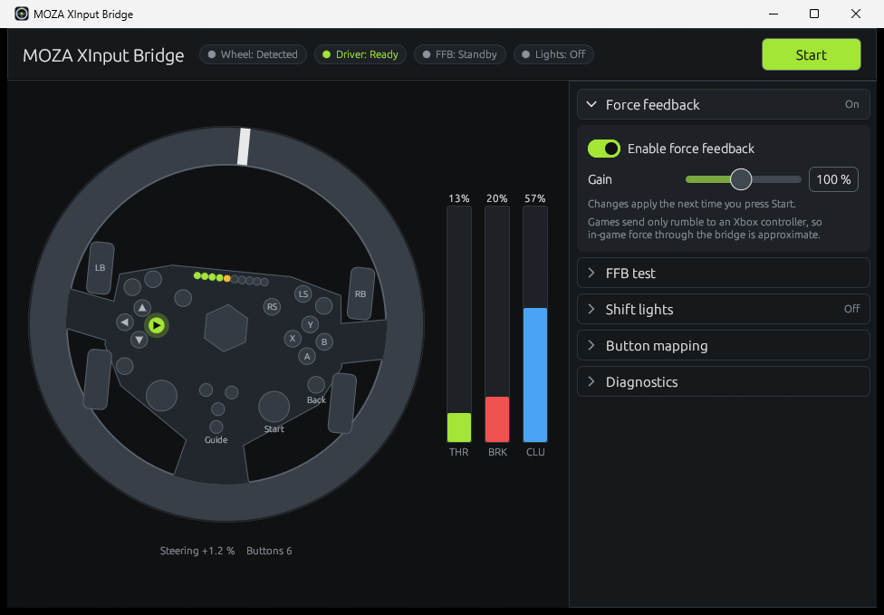

# moza-xinput-bridge

Use a **MOZA R3 racing wheel** as a virtual **Xbox 360 controller** on Windows,
with working **force feedback** speaking the wheelbase's native HID PID protocol.

Some games and tools only understand XInput gamepads. This bridge reads the
wheel, pedals and buttons directly over HID, feeds them into a virtual X360 pad
through the [ViGEm Bus Driver](https://github.com/nefarius/ViGEmBus), and
drives the wheelbase motor itself.

> Not affiliated with or endorsed by MOZA Racing. "MOZA" is used only to
> describe the hardware this software works with.



*The running view (captured in the built-in preview mode with synthetic input).*

## Features

- **Dashboard**: status pills for wheel, driver, force feedback and shift
  lights, a Start/Stop button that is always visible, and five collapsible
  settings sections on the right.
- **Start-up checklist**: before you start, the app checks the ViGEm driver,
  the wheel and Pit House, names what is missing and links to the driver
  download.
- **Live wheel view**: a drawn wheel that rotates with your steering, buttons
  that light up as you press them (labelled with the Xbox button they map to),
  the shift-light strip, and throttle, brake and clutch bars.
- **Full input bridge**: steering, throttle, brake, clutch and all wheel
  buttons to an X360 controller, polled at ~860 Hz.
- **Force feedback**: the exact PID report sequence a real game sends through
  the MOZA driver, decoded from USB captures and verified on hardware
  (see [docs/FFB.md](docs/FFB.md)).
- **FFB test panel**: push left/right at a chosen strength, live steering
  readout, and an automatic pulse test that *measures* wheel movement instead
  of relying on feel.
- **RPM shift lights**: drives the wheelbase's LED bar over its CDC serial
  port. Sources: a manual RPM slider and test sweep in the GUI, UDP telemetry
  (port 26999: raw u16 LE, ASCII number, or `{"rpm": 7200}`; SimHub can feed
  it), or rumble forwarded from the virtual controller.
- **Button mapping wizard**: press the wheel button for each Xbox button;
  skipped entries keep their previous value.
- **Persistent config**: button mapping, pedal calibration and FFB settings in
  `app.json`, saved atomically.
- **Diagnostics**: `hid-probe` CLI for enumeration, raw report dumps, axis
  logging and torque tests.

## Supported hardware

| Device | VID | PID | Status |
|---|---|---|---|
| MOZA R3 wheelbase (+ R3 wheel, SR-P Lite pedals) | `0x346E` | `0x0005` | Verified |
| MOZA R3 (alternate PID) | `0x346E` | `0x0015` | Detected, not verified |

Other MOZA bases use the same protocol family and may work, but are untested.

## Requirements

- Windows 10/11 (x64)
- [ViGEm Bus Driver](https://github.com/nefarius/ViGEmBus/releases)
- Rust stable toolchain with the MSVC target, to build from source

MOZA Pit House may stay installed. Force feedback works with it running, but
its telemetry session shares the wheel's input report and can make the pedal
axes jitter. **Close Pit House for clean pedal input** (`hid-probe --axislog`
shows whether it is interfering).

## Download

Prebuilt Windows binaries are attached to every
[release](https://github.com/mstumberger/moza-xinput-bridge/releases/latest):

- `moza-xinput-bridge-<version>-windows-x64.zip`: the app, `hid-probe`,
  `pedal_log`, README, license and the FFB notes
- `moza-xinput-bridge-<version>.exe`: the app alone
- `SHA256SUMS.txt`: checksums

Builds are not code-signed, so Windows SmartScreen may warn on first launch.

## Build and run

```powershell
git clone https://github.com/mstumberger/moza-xinput-bridge.git
cd moza-xinput-bridge
cargo build --release
.\target\release\moza-xinput-bridge.exe
```

The app runs windowed with no console. It logs to `%TEMP%\moza_mapper.log`.

## Usage

1. Install the ViGEm Bus Driver and plug in the wheel. The app opens to a
   checklist that shows what is ready and what is missing.
2. Click **Start** (in the top bar or in the checklist). A virtual Xbox 360
   controller appears and the checklist turns into the live wheel view. Turn
   the wheel and press buttons to see them respond. **Stop** ends the bridge.
3. The right-hand column has five sections; opening one closes the others, and
   the app remembers which was open.
   - **Force feedback**: **Enable force feedback** and **Gain** (applied on the
     next Start).
   - **FFB test**: click **Open FFB test**, set **Strength**, then hold
     **Push left** or **Push right**, or run **Auto pulse test** with your
     hands off the wheel. The result card says how far the wheel moved for each
     pulse. Use **Close FFB test** when done.
   - **Shift lights**: **Enable shift lights**, then set **Max RPM**, **LEDs**
     and the thresholds. Sources are **UDP telemetry** and **Controller
     rumble**; **Manual RPM** and **Test sweep** let you try the lights.
   - **Button mapping**: shows which wheel button drives each Xbox button.
     **Re-learn mapping** starts the wizard (stop the bridge first).
   - **Diagnostics**: raw button grid, **Steering range** (how far the drawn
     wheel turns), report rate, **Open log file** and **Open config folder**.

### Default button mapping

Wheel button numbers are 1-based (Joystick Gremlin numbering).

| Xbox | Wheel | Xbox | Wheel |
|---|---|---|---|
| A | 1 | LB (left paddle) | 13 |
| B | 2 | RB (right paddle) | 14 |
| X | 3 | LS | 33 |
| Y | 4 | RS | 34 |
| D-pad U/R/D/L | 5/6/7/8 | Back | 35 |
| Guide | 38 | Start | 36 |

### Configuration

`app.json` lives next to the executable when that folder is writable, and in
`%APPDATA%\moza_mapper\` otherwise.

## How it works

### Input (42-byte report, ~860 Hz)

| Bytes | Content |
|---|---|
| 0 | Report ID `0x01` |
| 1-2 | Steering, u16 LE |
| 3-16 | Seven u16 axes, idle `0x8000`; throttle 5-6, brake 11-12, clutch 15-16 (all travel upward when pressed) |
| 17+ | Button bitmask from byte 17 bit 4 (bits 0-3 are status bits) |

### Shift lights (CDC serial)

The LED bar is not on the HID interface. The wheelbase also exposes a CDC
serial port, and Pit House drives the lights with frames on its bulk-OUT
endpoint:

```
7E <len:u8> <cmd:u16 LE> <data[len]> <cksum>     cksum = (sum of preceding bytes + 0x0D) & 0xFF
cmd 0x1841, data FD DE 00 00 <mask:u16 BE>       bit i lights LED i
```

### Force feedback

The R3 exposes a standard HID PID interface (interface `MI_02`). FFB reports
go over the interrupt-OUT pipe:

```
0C 08                    device control: reset
0C 01                    device control: enable actuators
0D FF                    device gain 100 %
05 01 00 00              set constant force, block 1, magnitude 0
01 01 01 FFFF ... 2823   set effect: block 1, constant force, infinite, direction 90.00 deg
0A 01 01 01              effect operation: start block 1
05 01 <i16 LE>           stream the torque (positive = turn left, negative = right)
```

Device Control is a **bitfield** and effect types are **1-based indices**.
Misreading those two points is why earlier attempts produced no force. The
full investigation, including the capture method, is in
[docs/FFB.md](docs/FFB.md).

## Diagnostics

```powershell
.\target\release\hid-probe.exe               # enumerate + stream decoded input
.\target\release\hid-probe.exe --raw         # feature-report scan + raw dump
.\target\release\hid-probe.exe --axislog     # log all axes (spot Pit House interference)
.\target\release\hid-probe.exe --torque-lib  # +-25 % torque pulses, measures movement (hands off!)
.\target\release\pedal_log.exe               # 90 s CSV log of the seven pedal axes
```

## Project layout

```
src/hid        device discovery, descriptor parsing, report decoding
src/config     persistent config, default R3 mapping
src/mapping    1-based button mapping + learning wizard
src/output     ViGEm X360 target, report builder, FFB notifications
src/ffb        HID PID force feedback: report encoding, Win32 transport, torque channel
src/rpm        shift lights: serial frame protocol, COM port transport, UDP telemetry
src/gui/        egui UI: dashboard, theme, drawn wheel, bridge control, wizard, FFB and lights
src/bin        hid-probe and pedal_log diagnostics
```

## Known limitations

- XInput only carries two rumble motor strengths, with no direction. In-game
  force through the virtual pad is therefore mapped from the large rumble
  motor and cannot reproduce directional steering forces. The torque channel
  itself is fully directional (see the FFB test panel).
- Only the R3 (PID `0x0005`) has been verified on hardware.

## Releasing

Run **Actions > Release build > Run workflow**, pick `main` and type the
version, for example `0.0.1`. From a terminal:

```powershell
gh workflow run release.yml -f version=0.0.1
```

The [release workflow](.github/workflows/release.yml) builds that commit,
creates the tag `v0.0.1` and the GitHub release, and attaches the zip, the
exe, the dashboard screenshot and the checksums. The version is stamped into
the build only; nothing is pushed back, so it works with branch protection.
Publishing a release by hand with a `vX.Y.Z` tag also works: the workflow
then attaches the files to it.

Dev builds: add the `build` label to a pull request, or run **Actions > CI >
Run workflow**. The build is uploaded as a workflow artifact named
`<version>-<commit>`. To package locally:

```powershell
cargo build --release
powershell -ExecutionPolicy Bypass -File tools\package.ps1 -Version 0.0.1
```

## Development

Set `MOZA_GUI_PREVIEW=1` to run the GUI with synthetic input: the running view
and the hardware-only section bodies are shown without opening any device.
`tools\capture_window.ps1` saves a window to a PNG, which is how the screenshot
above was made:

```powershell
$env:MOZA_GUI_PREVIEW = '1'; .\target\debug\moza-xinput-bridge.exe
powershell -ExecutionPolicy Bypass -File tools\capture_window.ps1 -ProcName moza-xinput-bridge -Out shot.png
```

The app icon is generated by `tools\make_icon.ps1` (writes `assets\icon.ico` and
`assets\icon-256.png`); `build.rs` embeds it in the executables.

## Contributing

Issues and pull requests are welcome. For protocol work, a USBPcap capture
with phase markers is the most useful evidence: see the capture procedure in
[docs/FFB.md](docs/FFB.md). Please run `cargo test` before submitting.

## License

[MIT](LICENSE)
